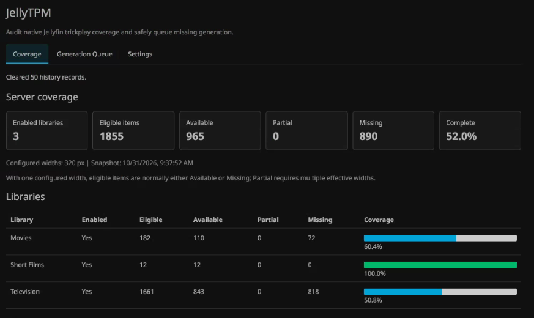
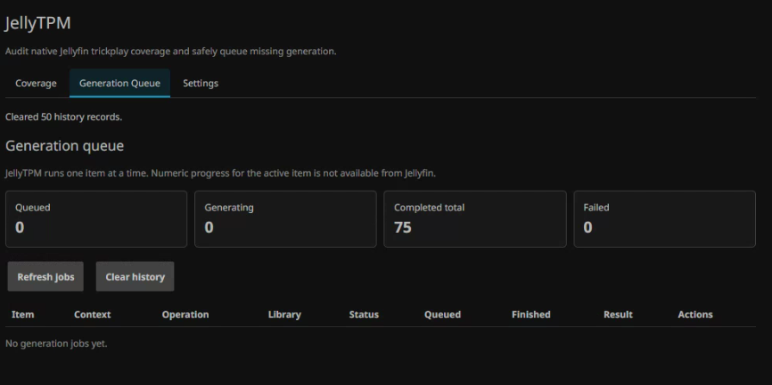

# JellyTPM

> Jellyfin TrickPlay Manager

[](https://jellyfin.org/)
[](https://dotnet.microsoft.com/)
[](https://github.com/KristopherPeck/JellyTPM/releases)
[](LICENSE)


JellyTPM gives Jellyfin administrators a searchable view of native trickplay coverage and a controlled queue for generating, previewing, and replacing trickplay thumbnails.

## AI development disclosure

JellyTPM was designed and developed collaboratively by the project maintainer with assistance from OpenAI Codex. AI was used during research, implementation, refactoring, security review, troubleshooting, and documentation. AI-generated suggestions are treated as drafts rather than authoritative results; the maintainer directs the project, reviews changes, and is responsible for validating release candidates before publication.

## Features

- Server-wide and per-library coverage totals
- Paged inventory with library, status, title, show, and season filtering
- Available, Partial, Missing, Library disabled, and Not eligible states
- Expected widths, available widths, and thumbnail counts
- Television series, season, movie, and extra context where Jellyfin provides it
- Authenticated frame previews with resolution and timeline controls
- Non-destructive generation for individual Missing or Partial items
- Filtered batch generation with configurable batch and active-queue limits
- Explicitly confirmed replacement regeneration for one item
- Durable single-worker queue with restart recovery and per-item deduplication
- Post-generation validation, retained history, queued-job cancellation, and completed totals
- Separate Coverage, Generation Queue, and Settings tabs in Jellyfin's administrator dashboard

## Screenshots

### Coverage dashboard

Server-wide totals and per-library completion show where trickplay generation is still needed.



### Generation queue

Queue status and retained history keep generation activity visible without leaving the Jellyfin dashboard.



## How coverage is classified

| Status | Meaning |
| --- | --- |
| Available | Every currently configured effective trickplay width has thumbnails. |
| Partial | At least one configured width is available and at least one is missing. |
| Missing | No configured trickplay width is available. |
| Library disabled | Trickplay extraction is disabled for the containing library. |
| Not eligible | Jellyfin cannot process the video, or it is excluded by JellyTPM settings. |

An item is normally Partial only when multiple effective widths are configured. Effective widths account for the source video width.

Collections/BoxSets are excluded because they duplicate items from their source libraries. Music, book, and zero-video libraries are also omitted. Disabled video libraries remain visible with coverage shown as `N/A`.

## Generation and regeneration

Generate missing uses Jellyfin's non-replacement operation. JellyTPM runs one job at a time and marks it Completed only after every expected resolution has been verified.

Regenerate is available from the Preview dialog when an item already has trickplay data. It invokes Jellyfin's replacement operation, which can remove existing trickplay files and database records before rebuilding them. JellyTPM therefore requires explicit confirmation and prevents simultaneous jobs for the same item. If replacement fails, the item can temporarily have no usable trickplay preview.

Jellyfin does not expose reliable numeric per-file trickplay progress to plugins, so JellyTPM reports lifecycle states: Queued, Generating, Completed, Failed, or Cancelled.

## Queue and history settings

| Setting | Default | Purpose |
| --- | ---: | --- |
| History retention | 30 days | Removes terminal records older than the configured age. |
| Maximum retained history | 50 | Limits detailed Completed, Failed, and Cancelled records. |
| Preserve completed total | On | Keeps the Completed counter when detailed history is pruned or cleared. |
| Maximum filtered batch size | 500 | Limits the candidates selected by one batch request. |
| Maximum active queue | 1,000 | Caps all Queued and Generating jobs across requests. |

Active jobs are never removed by history retention. Lowering the active-queue limit does not cancel existing work; it prevents new jobs until the queue falls below the limit.

## Requirements

- Jellyfin Server 12.4
- A Jellyfin administrator account
- .NET 10 SDK only when developing or packaging the plugin

JellyTPM should be installed only on the Jellyfin version targeted by its release manifest. Back up the Jellyfin data directory before testing beta releases or running broad replacement operations.

## Installation

### Plugin repository

1. Open **Dashboard → Plugins → Repositories**.
2. Select **Add**.
3. Name the repository `JellyTPM` and use this URL:

   ```text
   https://raw.githubusercontent.com/KristopherPeck/JellyTPM/main/manifest.json
   ```

4. Open **Catalog** and install JellyTPM from the **General** category.
5. Restart Jellyfin.
6. Open **Dashboard → JellyTPM**.

### Manual installation

1. Download `JellyTPM_<version>.zip` from the matching [GitHub release](https://github.com/KristopherPeck/JellyTPM/releases).
2. Extract the archive into a `JellyTPM` directory beneath Jellyfin's plugin directory.
3. Restart Jellyfin.

Common plugin locations include:

| Installation | Plugin directory |
| --- | --- |
| Windows tray install | `%ProgramData%\Jellyfin\Server\plugins` |
| Windows user install | `%LocalAppData%\jellyfin\plugins` |
| Common Linux packages | `/var/lib/jellyfin/plugins` |

## Development

JellyTPM is a conventional .NET Jellyfin server plugin. `Web/dashboard.html` is embedded directly in the plugin assembly; Node.js and Docker are not used.

The project references `Jellyfin.Controller` and `Jellyfin.Model` 12.4.0.

Testing and packaging are intentionally performed on a separate designated workstation.

### Release packaging

From PowerShell on the build workstation:

```powershell
.\scripts\package-release.ps1
```

The script restores and publishes the project version, stages an allowlist of plugin files, rejects server assemblies and native runtime files, and writes the ZIP plus MD5 and SHA-256 checksum files beneath `artifacts/`.

After the exact release ZIP has been validated, update its matching manifest checksum and UTC timestamp with a fresh build:

```powershell
.\scripts\package-release.ps1 -UpdateManifest
```

`-SkipBuild` can repackage an existing `artifacts/publish/<version>` directory, but it cannot be combined with `-UpdateManifest`.

## Security

All JellyTPM API routes require Jellyfin's elevated Administrator policy. Administrative responses disable caching, and plugin responses do not expose full media paths.

Generation can consume substantial CPU, GPU, and storage I/O. Regeneration is destructive to existing trickplay data by design, and administrators should use it only after confirming the selected item and maintaining an appropriate Jellyfin backup.

See [SECURITY.md](SECURITY.md) for the security boundary and private vulnerability-reporting guidance.

## Roadmap

- Retry controls for failed jobs
- Best-effort cancellation of active generation when Jellyfin exposes a safe mechanism
- Detection of native Jellyfin scheduled-task generation activity

## License

JellyTPM is licensed under [GPL-3.0-only](LICENSE).

